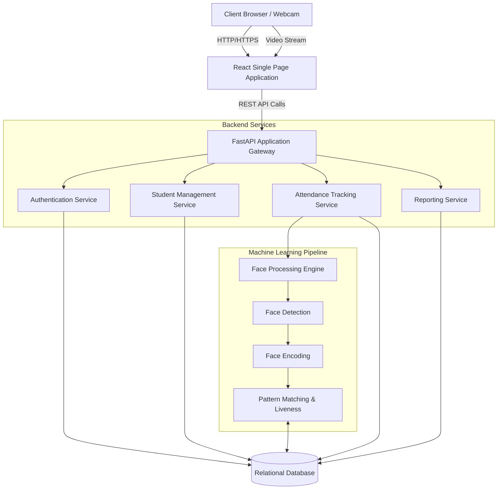
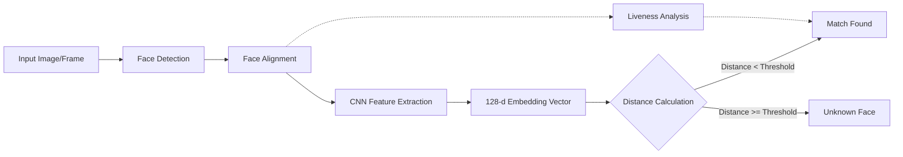
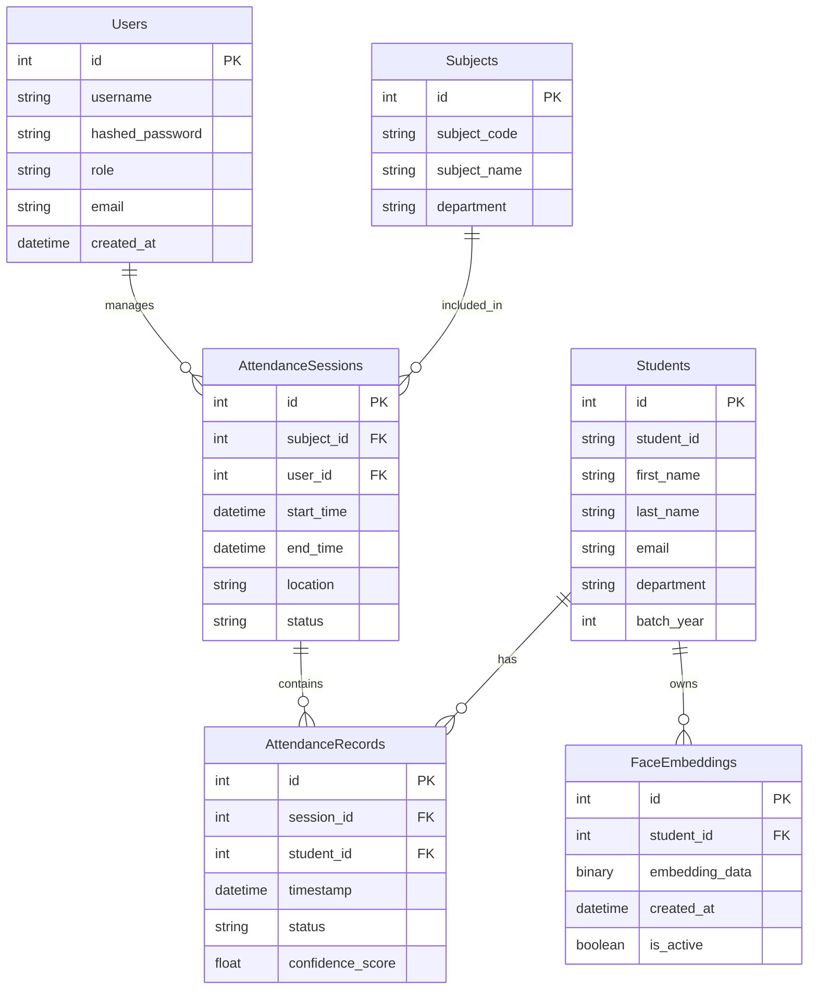

# AI Attendance Management System


## Project Overview

The AI Attendance Management System is an advanced, automated solution designed to streamline the process of tracking student attendance in educational institutions. Leveraging state-of-the-art computer vision and machine learning techniques, this system completely eliminates the need for manual roll calls, paper-based registers, or traditional hardware-dependent biometric scanners. By simply utilizing standard webcams or IP cameras, the system can instantly detect, recognize, and log the attendance of multiple students simultaneously in real-time.

At its core, the application integrates a robust FastAPI backend with a modern React-based frontend, providing a seamless user experience for both administrators and faculty members. The system incorporates deep learning models for face encoding and matching, ensuring high accuracy even in varying lighting conditions or with minor changes in facial appearance. Furthermore, it implements advanced liveness detection algorithms to prevent spoofing attempts using photographs or videos, thereby maintaining the highest standards of integrity and security in attendance recording.

This project was developed with a strong emphasis on scalability, maintainability, and user-centric design. It offers comprehensive analytics dashboards, automated report generation, and real-time notifications, transforming raw attendance data into actionable insights for educational administrators. The modular architecture ensures that new features, such as integration with existing Student Information Systems (SIS) or support for edge computing devices, can be added with minimal friction.

## Problem Statement

Traditional methods of tracking attendance in educational institutions are plagued by numerous inefficiencies and vulnerabilities. Manual roll calls are extremely time-consuming, often consuming 10-15% of a typical lecture duration, thereby reducing valuable instructional time. Paper-based registers are prone to human error, loss, and unauthorized alterations. 

Moreover, traditional systems are highly susceptible to "proxy" attendance, where students mark their absent peers as present. While some institutions have adopted biometric systems (like fingerprint scanners) or RFID/Smart Card readers, these solutions require significant upfront hardware investment, regular maintenance, and create physical bottlenecks at classroom entrances. They also raise hygiene concerns, which have become particularly prominent in recent times. There is a pressing need for a frictionless, software-driven, and highly accurate attendance system that can operate on commodity hardware.

## Objectives

1.  **Automate Attendance Tracking**: Completely eliminate manual roll calls by deploying an AI-driven face recognition system capable of logging attendance in real-time.
2.  **Eliminate Proxy Attendance**: Ensure the absolute integrity of attendance records by verifying the physical presence of students through advanced liveness detection.
3.  **Minimize Hardware Dependency**: Design a system that functions efficiently using standard webcams and commodity server hardware, removing the need for specialized biometric scanners.
4.  **Provide Real-Time Analytics**: Offer dynamic, interactive dashboards for administrators and faculty to monitor attendance trends, identify chronic absenteeism, and generate actionable reports.
5.  **Ensure Data Security and Privacy**: Implement stringent access controls, secure biometric data storage (storing embeddings rather than raw images), and comply with standard data protection guidelines.
6.  **Deliver a Seamless User Experience**: Build an intuitive, responsive, and accessible web interface for managing students, subjects, and attendance sessions with minimal training required.
7.  **Build a Scalable Architecture**: Utilize a modern technology stack (FastAPI, React, Docker) to ensure the system can effortlessly scale to accommodate thousands of students across multiple campuses.

## Feature List

### Authentication & Authorization
*   **Role-Based Access Control (RBAC)**: Distinct dashboards and permissions for Administrators and Faculty members.
*   **Secure Authentication**: JWT (JSON Web Token) based authentication mechanism.
*   **Password Security**: Implementation of bcrypt for robust password hashing.
*   **Session Management**: Secure session handling with automatic timeouts for inactive users.

### Student Management
*   **Comprehensive Profiles**: Detailed student records including personal information, enrolled courses, and contact details.
*   **Bulk Operations**: Support for CSV/Excel imports to quickly onboard hundreds of students.
*   **Biometric Registration**: Intuitive interface for capturing and processing student face data to generate baseline embeddings.
*   **Profile Updates**: Easy management of student data, including the ability to update reference face images if necessary.

### Face Recognition & Machine Learning
*   **Real-Time Detection**: Continuous face detection from live video streams.
*   **High-Accuracy Recognition**: Robust matching against stored embeddings using optimized distance metrics.
*   **Liveness Detection**: Integrated checks (e.g., eye blink detection, texture analysis) to prevent spoofing with photos or videos.
*   **Multi-Face Processing**: Capable of detecting and recognizing multiple faces within a single frame simultaneously.
*   **Lighting Compensation**: Pre-processing steps to normalize images under varying lighting conditions.

### Attendance Management
*   **Session Creation**: Ability for faculty to create specific attendance sessions linked to subjects, classrooms, and time slots.
*   **Live Monitoring**: Real-time view of recognized students as they are logged into the system.
*   **Manual Overrides**: Faculty capability to manually mark attendance for edge cases (e.g., student with physical injury preventing recognition).
*   **Status Tracking**: Categorization of attendance (Present, Absent, Late).

### Reports & Analytics
*   **Interactive Dashboards**: Visual representation of daily, weekly, and monthly attendance trends using charts and graphs.
*   **Exportable Reports**: Generate detailed reports in PDF, CSV, and Excel formats for administrative use.
*   **Defaulter Identification**: Automated flagging of students falling below mandated attendance thresholds.
*   **Subject-Wise Analytics**: Granular breakdown of attendance statistics per course or module.

### Security
*   **Data Encryption**: End-to-end encryption for API communication (when deployed with HTTPS).
*   **Embedding Storage**: Storing only irreversible 128-dimensional mathematical representations of faces, never the raw images.
*   **Input Validation**: Comprehensive sanitization of all user inputs to prevent SQL injection and XSS attacks.
*   **Audit Logging**: Tracking of critical actions performed by administrators and faculty.

### System Configuration
*   **Parameter Tuning**: Admin capability to adjust recognition thresholds (tolerance levels) and liveness detection strictness.
*   **System Health Monitoring**: Dashboards to monitor backend service status and database connectivity.
*   **Backup & Restore**: Utilities for managing database backups to prevent data loss.

## Technology Stack

| Category | Technology | Description |
| :--- | :--- | :--- |
| **Backend Framework** | FastAPI | High-performance Python web framework for building APIs. |
| **Frontend Framework** | React.js | JavaScript library for building interactive user interfaces. |
| **Styling** | Tailwind CSS | Utility-first CSS framework for rapid UI development. |
| **Database** | SQLite / PostgreSQL | Relational database management system (SQLite for dev, Postgres for prod). |
| **ORM** | SQLAlchemy | SQL toolkit and Object-Relational Mapping library for Python. |
| **Machine Learning / CV**| OpenCV, dlib, face_recognition | Libraries for image processing, face detection, and embedding generation. |
| **Authentication** | JWT (PyJWT), Passlib | Token-based authentication and password hashing. |
| **Testing** | Pytest, Jest | Frameworks for backend and frontend unit/integration testing. |
| **Containerization** | Docker, Docker Compose | Tools for packaging and deploying the application consistently. |
| **HTTP Client** | Axios | Promise-based HTTP client for the browser. |

## System Architecture



## ML Methodology

The machine learning pipeline is the core of the attendance system, designed for speed and accuracy. It follows a sequential process for every frame or image processed:

1.  **Face Detection**: The system first locates human faces within the given image. We utilize robust algorithms (like HOG - Histogram of Oriented Gradients, or CNN-based detectors) to find bounding boxes around faces, regardless of scale or position.
2.  **Face Alignment**: To improve recognition accuracy, detected faces are geometrically transformed to align facial landmarks (eyes, nose, mouth) to a standard reference point.
3.  **Face Encoding**: The aligned face image is passed through a pre-trained Deep Convolutional Neural Network (such as a ResNet architecture). This network outputs a 128-dimensional vector (embedding) that represents the unique features of the face.
4.  **Face Matching**: The generated embedding is compared against the database of known student embeddings. We calculate the Euclidean distance (or Cosine Similarity) between the vectors. If the distance is below a carefully calibrated threshold, a match is confirmed.
5.  **Liveness Detection**: Parallel to recognition, a liveness check analyzes the temporal changes (like Eye Aspect Ratio for blinking) or spatial textures to confirm the subject is a real, live person and not a spoofing attempt.



## Database Schema (ER Diagram)



## Local Installation & Setup

### Prerequisites
*   Python 3.11 or higher
*   Node.js 18.x or higher
*   npm or yarn package manager
*   CMake (required for dlib installation)
*   Git

### 1. Clone the Repository
```bash
git clone https://github.com/your-org/AI-Attendance-System.git
cd AI-Attendance-System
```

### 2. Backend Setup
```bash
cd backend
# Create and activate a virtual environment
python -m venv venv
source venv/bin/activate  # On Windows: venv\Scripts\activate

# Install required Python packages
pip install -r requirements.txt

# Run database migrations (creates SQLite db by default)
alembic upgrade head

# Create an initial admin user (using a provided script)
python scripts/create_admin.py
```

### 3. Frontend Setup
```bash
# Open a new terminal window
cd ../frontend

# Install Node modules
npm install

# Build Tailwind CSS (if required by your setup)
npm run build:css 
```

### 4. Environment Variables Configuration
Copy the `.env.example` file in the backend directory to `.env` and update the values as needed.

### 5. Start the Application
**Terminal 1 (Backend):**
```bash
cd backend
source venv/bin/activate
uvicorn main:app --reload --host 0.0.0.0 --port 8000
```

**Terminal 2 (Frontend):**
```bash
cd frontend
npm start
```
Access the application at `http://localhost:3000` and the API documentation at `http://localhost:8000/docs`.

## Environment Variables

| Variable Name | Description | Default Value | Required |
| :--- | :--- | :--- | :--- |
| `DATABASE_URL` | Connection string for the database. | `sqlite:///./attendance.db` | Yes |
| `SECRET_KEY` | Secret key for encoding JWT tokens. | (Generate a random string) | Yes |
| `ALGORITHM` | Algorithm used for JWT. | `HS256` | Yes |
| `ACCESS_TOKEN_EXPIRE_MINUTES`| Expiration time for auth tokens. | `30` | Yes |
| `FACE_MATCH_THRESHOLD` | Tolerance for face recognition (lower = stricter).| `0.6` | No |
| `ALLOW_ORIGINS` | CORS allowed origins. | `http://localhost:3000` | Yes |

## Running with Docker

For a streamlined setup without configuring local dependencies, you can use Docker Compose.

1.  Ensure Docker and Docker Compose are installed and running.
2.  Navigate to the project root directory.
3.  Execute the following command:
    ```bash
    docker-compose up --build -d
    ```
4.  The application will be available at:
    *   Frontend: `http://localhost:3000`
    *   Backend API: `http://localhost:8000`
5.  To stop the application:
    ```bash
    docker-compose down
    ```

## API Endpoints Overview

| Method | Endpoint | Description | Auth Required |
| :--- | :--- | :--- | :--- |
| `POST` | `/api/auth/login` | Authenticate user and return JWT. | No |
| `GET` | `/api/users/me` | Get current user details. | Yes |
| `GET` | `/api/students/` | List all students (paginated). | Yes |
| `POST` | `/api/students/` | Register a new student. | Yes (Admin) |
| `POST` | `/api/faces/register` | Upload images to generate student embeddings. | Yes (Admin) |
| `POST` | `/api/attendance/recognize` | Submit a frame for face recognition. | Yes |
| `GET` | `/api/sessions/` | List attendance sessions. | Yes |
| `POST` | `/api/sessions/` | Create a new attendance session. | Yes |
| `GET` | `/api/reports/daily` | Get daily attendance summary. | Yes |

*(Note: For the complete API reference, visit `http://localhost:8000/docs` while the backend is running).*

## Testing

The project includes comprehensive test suites for both the backend and frontend components.

### Backend Testing (Pytest)
```bash
cd backend
source venv/bin/activate
# Run all tests
pytest

# Run tests with coverage report
pytest --cov=app tests/
```

### Frontend Testing (Jest)
```bash
cd frontend
# Run all tests in interactive mode
npm test

# Run tests and generate coverage report
npm test -- --coverage
```

## Limitations

1.  **Hardware Dependency for Speed**: While the system runs on CPU, real-time processing of high-resolution video streams with multiple faces heavily benefits from GPU acceleration, which may not be available on all deployment servers.
2.  **Lighting Constraints**: Extreme lighting conditions (backlighting, very low light) can significantly degrade face detection and recognition accuracy.
3.  **Pose Variations**: The current models are optimized for near-frontal faces. Extreme profile angles may not be recognized reliably.
4.  **Occlusion**: Masks, heavy scarves, or large sunglasses that obscure significant facial features will prevent successful recognition.
5.  **Identical Twins**: Standard 2D face recognition models struggle to differentiate between identical twins, which may lead to false positives.
6.  **Network Latency**: For cloud deployments, transmitting video frames continuously to the backend can consume significant bandwidth and introduce latency.
7.  **Initial Setup Overhead**: Registering the baseline faces for an entire student body requires an initial time investment.

## Future Scope

1.  **Edge Computing Integration**: Moving the ML processing to edge devices (like Raspberry Pi or smart cameras) within the classroom to reduce network load and latency.
2.  **3D Face Recognition**: Incorporating depth sensors (like Intel RealSense) to completely eliminate 2D spoofing attacks and improve accuracy.
3.  **Emotion & Engagement Analysis**: Extending the ML pipeline to analyze aggregate student engagement and emotional state during lectures.
4.  **Integration with Major SIS**: Developing official plugins for seamless integration with popular Student Information Systems like Canvas, Moodle, or Blackboard.
5.  **Mobile Application**: Developing a native mobile app for faculty to manage attendance sessions directly from their smartphones.
6.  **Automated Alerting System**: Implementing SMS or WhatsApp integration to automatically notify parents of student absence.
7.  **Continuous Learning**: Implementing feedback loops where manual corrections by faculty are used to continuously re-train and improve the local model's accuracy.
8.  **Cloud-Native Architecture**: Migrating to a microservices architecture using Kubernetes for massive scale deployments across university networks.

## Privacy Considerations

Data privacy is a paramount concern in biometric systems. This project addresses privacy through the following mechanisms:
*   **No Image Storage**: The system does not store the raw images captured during the daily attendance process. Images are processed in-memory and immediately discarded.
*   **Mathematical Representations**: The system only stores 128-dimensional numerical vectors (embeddings). It is mathematically impossible to reconstruct a human face from this embedding.
*   **Data Minimization**: Only essential information required for academic tracking is collected and stored.
*   **Compliance**: Designed with GDPR and similar data protection regulations in mind, providing mechanisms for data deletion upon student request.

## Screenshots

*(Placeholder for actual application screenshots)*

*   **Login Dashboard**: `[Insert Screenshot Here]`
*   **Admin Analytics Overview**: `[Insert Screenshot Here]`
*   **Live Attendance Tracking View**: `[Insert Screenshot Here]`
*   **Student Registration Module**: `[Insert Screenshot Here]`

## License

This project is licensed under the MIT License - see the [LICENSE](LICENSE) file for details.

## Acknowledgments

*   The creators of the powerful [dlib](http://dlib.net/) library.
*   Adam Geitgey for the excellent [face_recognition](https://github.com/ageitgey/face_recognition) Python wrapper.
*   The [FastAPI](https://fastapi.tiangolo.com/) and [React](https://reactjs.org/) communities for their comprehensive documentation and support.
