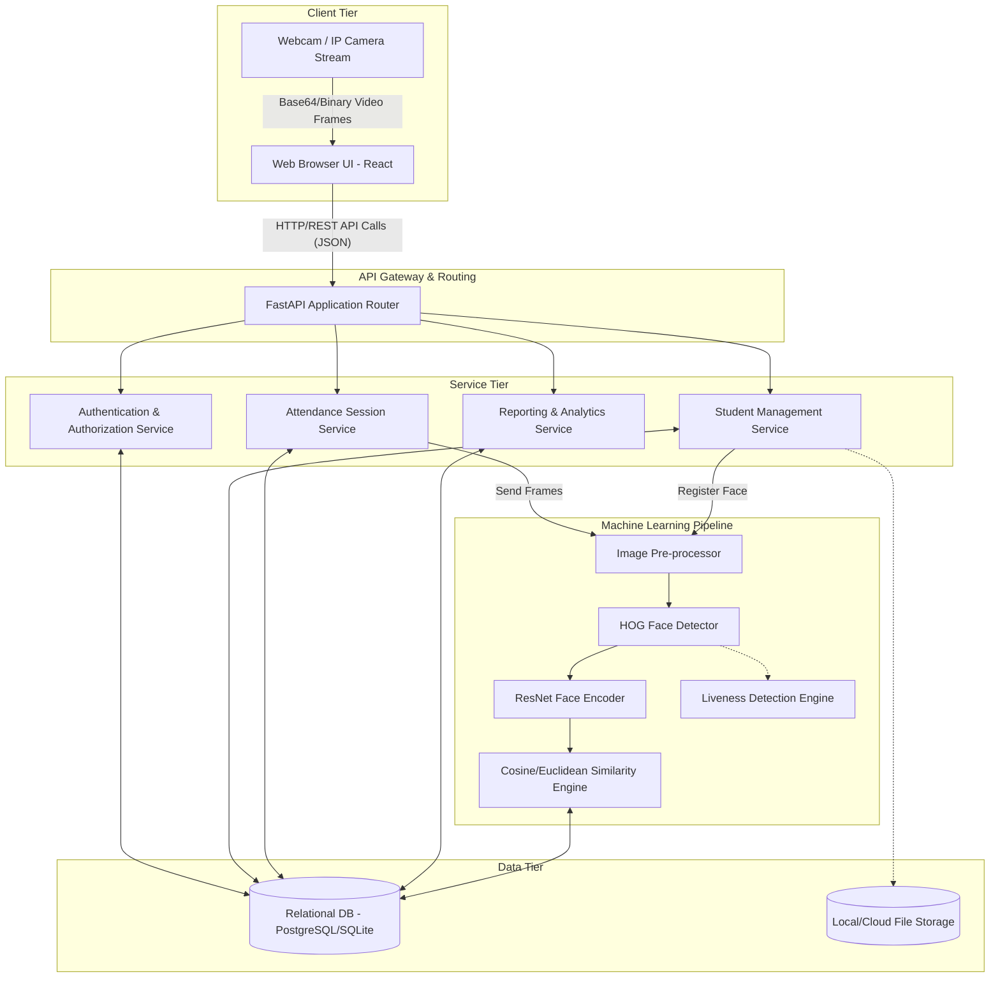

# System Architecture

## Overview
The AI-Based Attendance Management System is built upon a modern, highly decoupled microservices-inspired architecture. This approach separates the presentation logic, application logic, and data persistence layers, ensuring scalability, ease of maintenance, and the ability to upgrade individual components independently. The core architecture is a traditional client-server model heavily augmented by a specialized Machine Learning pipeline for biometric processing.

## High-Level Architecture Diagram

## Component Description

### 1. Client Tier (Frontend)
The frontend is a Single Page Application (SPA) built using **React.js**. It is responsible for all user interactions and rendering the user interface.
*   **Webcam Integration:** Uses browser APIs to access the local webcam, capture frames at a set interval, and transmit them to the backend.
*   **State Management:** Manages UI state, authentication tokens (JWT), and real-time attendance lists.
*   **Routing:** React Router handles navigation between administrative dashboards and live tracking views without page reloads.

### 2. Application Tier (Backend API)
The backend is powered by **FastAPI**, a high-performance Python framework.
*   **API Gateway:** Routes incoming HTTP requests to the appropriate internal services.
*   **Authentication Service:** Validates JWTs, manages user sessions, and enforces Role-Based Access Control (RBAC).
*   **Core Services:** Handles CRUD operations for students, subjects, and sessions. Connects the frontend to the ML pipeline.

### 3. Machine Learning Tier
This is the specialized computational core of the system.
*   **Face Detector:** Locates bounding boxes of faces within a frame using HOG.
*   **Face Encoder:** Passes the aligned face through a Deep CNN to extract a 128-d embedding vector.
*   **Similarity Engine:** Calculates mathematical distances between the extracted vector and database vectors to find a match.
*   **Liveness Engine:** Analyzes temporal data (like blinking) to prevent spoofing.

### 4. Data Tier
Manages persistence using a relational database (managed via SQLAlchemy).
*   **Structured Data:** Stores users, student metadata, session details, and attendance logs.
*   **Biometric Data:** Stores the 128-d embeddings as serialized arrays. Raw images are typically not stored to preserve privacy.

## Technology Justification

*   **FastAPI over Django/Flask:** FastAPI natively supports asynchronous execution (`asyncio`), which is crucial when handling multiple concurrent video streams and I/O-bound database queries. It is significantly faster than Flask and less bloated than Django.
*   **React over Vanilla JS:** The requirement to display dynamic data (like a live updating list of recognized students alongside a video feed) necessitates a robust state management system, which React provides efficiently via its Virtual DOM.
*   **HOG/ResNet over Haar Cascades:** While Haar cascades are faster, they fail frequently under varying lighting. The HOG + ResNet combination provides near human-level accuracy, which is non-negotiable for an attendance system.
