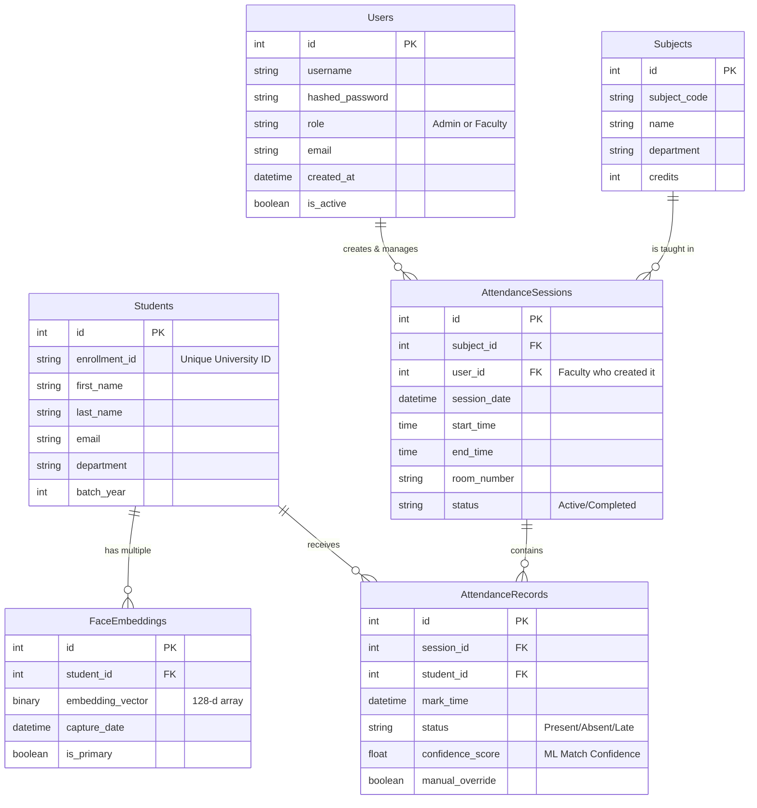

# Database Design and Schema

## Overview
The database for the AI-Based Attendance Management System is designed using a Relational Database Management System (RDBMS). It is structured in the 3rd Normal Form (3NF) to ensure data integrity, eliminate data redundancy, and provide efficient query performance. The system uses SQLAlchemy ORM (Object-Relational Mapping), allowing seamless switching between SQLite for local development and PostgreSQL for production deployments.

## Entity-Relationship (ER) Diagram

## Table Descriptions

### 1. Users Table
Stores credentials for the administrative and faculty staff who manage the system.
*   **role**: Crucial for enforcing Role-Based Access Control (e.g., only 'Admin' can register new students, 'Faculty' can only start sessions).
*   **hashed_password**: Passwords must never be stored in plain text. They are hashed using bcrypt.

### 2. Students Table
Maintains the demographic and academic profile of the students.
*   **enrollment_id**: The unique identifier used by the university (e.g., Roll Number). Indexed for fast lookups.

### 3. FaceEmbeddings Table
This is a critical table that stores the biometric data.
*   **embedding_vector**: Stores the 128-dimensional floating-point array generated by the ML pipeline. Stored as a binary BLOB or serialized JSON.
*   **is_primary**: A student might have multiple embeddings captured under different conditions. This flags the primary one used for matching.
*   *Privacy Note*: Raw images are intentionally NOT stored in the database.

### 4. Subjects Table
A catalog of courses offered by the institution.

### 5. AttendanceSessions Table
Represents a specific lecture or class instance.
*   Links the Faculty (`user_id`), the Course (`subject_id`), and the temporal data (start/end times).

### 6. AttendanceRecords Table
The transaction table where the actual attendance is logged.
*   Acts as a junction between `AttendanceSessions` and `Students`.
*   **confidence_score**: Stores the mathematical distance returned by the ML model. Useful for auditing matches that were close to the threshold.
*   **manual_override**: A boolean flag indicating if the faculty member manually marked the student present, overriding the AI.

## Database Normalization
The schema adheres to normalization rules:
*   **1NF**: All attributes contain atomic values.
*   **2NF**: All non-key attributes are fully functionally dependent on the primary key.
*   **3NF**: There are no transitive dependencies. For example, the `AttendanceRecords` table only stores the `student_id`, not the student's name, preventing data anomalies if a student's name changes.

## Indexing Strategy
To ensure real-time performance during facial matching, indexes are heavily utilized:
*   Primary Keys are automatically indexed.
*   An index is placed on `enrollment_id` in the `Students` table.
*   Foreign keys (`session_id`, `student_id`) in the `AttendanceRecords` table are indexed to speed up the generation of complex analytical reports (e.g., calculating a student's total attendance across a semester).
