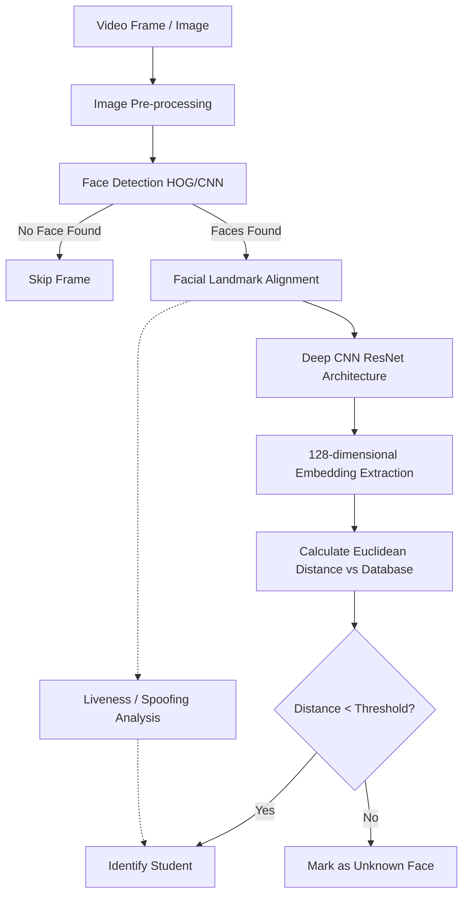

# Machine Learning Methodology

## Overview
The success of the AI Attendance Management System relies entirely on the accuracy, speed, and reliability of its Machine Learning (ML) pipeline. The system utilizes Computer Vision (CV) techniques to process video frames and Deep Learning (DL) architectures to extract and match facial features. The primary objective is to accurately identify students in real-time under varying classroom conditions while actively preventing spoofing attempts.

## Core ML Pipeline

The pipeline executes sequentially for every processed frame. It is optimized to reject non-matching data as early as possible to conserve computational resources.

## Phase 1: Pre-processing and Detection
Raw frames captured from webcams often suffer from poor lighting, noise, and varying color balances.
1.  **Grayscale Conversion**: Color data is generally unnecessary for structural face detection. Converting to grayscale reduces the computational load significantly.
2.  **Histogram Equalization**: Normalizes contrast to improve feature visibility in poorly lit environments.
3.  **Face Detection**: We utilize the Histogram of Oriented Gradients (HOG) algorithm combined with a Linear Support Vector Machine (SVM). HOG is highly robust to variations in lighting because it evaluates the *direction* of edges rather than pixel intensity. For deployments requiring higher accuracy (and possessing GPU acceleration), the system can be configured to use a CNN-based detector (like SSD or MTCNN).

## Phase 2: Alignment and Feature Extraction
Detecting the face is not enough; a tilted face will produce a vastly different embedding than a straight face.
1.  **Landmark Estimation**: The system identifies 68 specific points on the face (corners of the eyes, tip of the nose, edges of the mouth).
2.  **Affine Transformation**: Using these landmarks, the image is geometrically warped (rotated, scaled, and sheared) so that the eyes and mouth are aligned to a standardized reference coordinate system.
3.  **Feature Extraction (Encoding)**: The aligned face is fed into a pre-trained ResNet (Residual Network) architecture. The network has been trained on a massive dataset of millions of faces using a triplet loss function. This function forces the network to output a 128-dimensional vector where vectors for the *same* person are mathematically close, and vectors for *different* people are far apart.

## Phase 3: Matching and Distance Metrics
The core of recognition is a mathematical comparison.
1.  **Distance Calculation**: The newly generated 128-d vector is compared against all registered student vectors in the database. We calculate the Euclidean distance (the straight-line distance in 128-dimensional space) between the vectors.
2.  **Thresholding**: A critical hyperparameter is the threshold value (typically set around 0.6).
    *   If `Distance < 0.6`: The faces belong to the same person (Match).
    *   If `Distance >= 0.6`: The faces belong to different people (Mismatch).

## Phase 4: Liveness Detection (Anti-Spoofing)
To prevent "proxy" attendance using photographs or tablets, liveness detection operates in parallel.
*   **Eye Aspect Ratio (EAR)**: By continuously analyzing the eye landmarks across consecutive frames, the system calculates the EAR. A sudden, sharp drop in the EAR followed by a rapid rise indicates a natural human blink. Static photos cannot blink, thereby failing the liveness check.
*   **Texture Analysis**: Advanced deployments may analyze the micro-textures of the detected face; a flat 2D screen reflects light differently than a 3D human face.

## Performance Metrics and Evaluation
The system's ML models are continuously evaluated against standard metrics:
*   **True Positive Rate (Recall)**: Percentage of present students correctly identified.
*   **False Acceptance Rate (FAR)**: Percentage of times an unknown person is incorrectly matched to a student record. (Must be kept extremely low).
*   **False Rejection Rate (FRR)**: Percentage of times a present student is not recognized. (Often caused by poor lighting or severe occlusion).
*   **Processing Latency**: The time taken from frame capture to identification result. The target is < 500ms per frame to maintain real-time performance.
